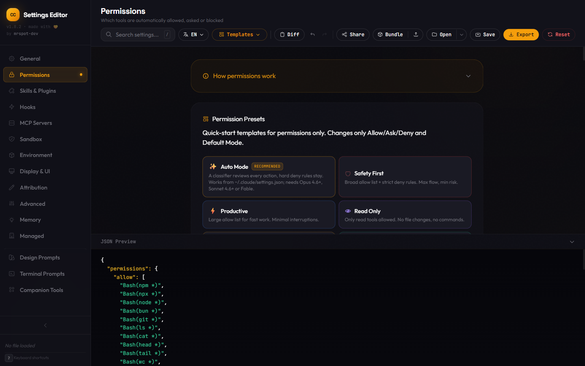
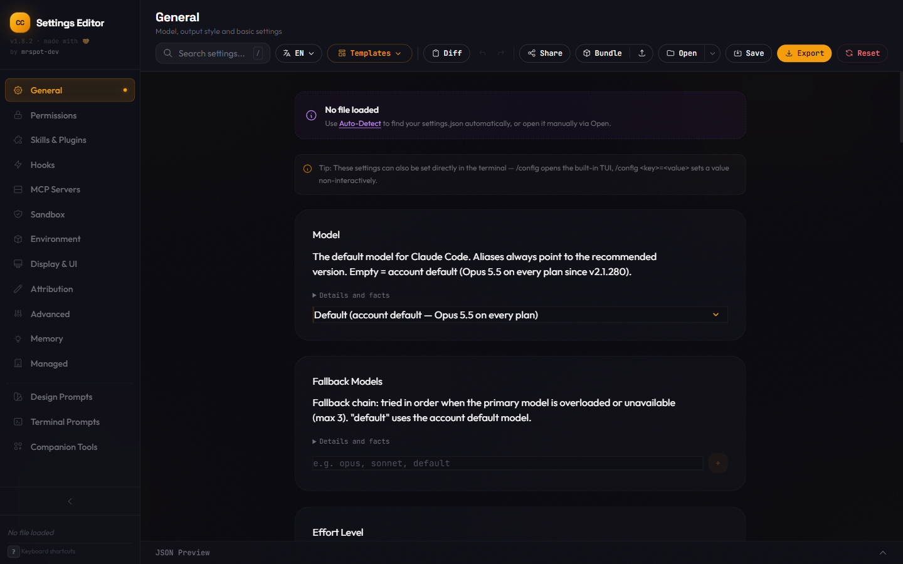

<p align="center">
  
</p>

<h1 align="center">Claude Settings Editor</h1>

<p align="center">
  A visual editor for Claude Code <code>settings.json</code> that runs as a single HTML file in your browser.
</p>

<p align="center">
  <a href="https://github.com/mrspot-dev/claude-settings-editor/releases/latest"></a>
  
  <a href="LICENSE"></a>
</p>

<p align="center">
  
</p>

## Quick start

**Try it online:** [mrspot-dev.github.io/claude-settings-editor](https://mrspot-dev.github.io/claude-settings-editor/)

The hosted version runs entirely in your browser. Your `settings.json` is read and written on your own machine through the File System Access API, and nothing is uploaded.

For regular use, keep a local copy of `claude-settings-editor.html`. A downloaded file changes only when you replace it, while a hosted page always serves whatever is currently deployed. That matters for a file that may contain API keys.

**Option A: open the file**

1. Download `claude-settings-editor.html`.
2. Open it in a Chromium browser (Chrome, Edge, Arc).
3. Click **Open** and pick your `settings.json`.
4. Edit, then click **Save** to write it back to disk.

**Option B: let the script find your files**

1. Download the repo, or just `claude-settings-editor.html` and `open-editor.py`.
2. Run the companion script:
   ```bash
   python open-editor.py
   ```
3. It lists the `settings.json` files it finds, you pick one, and the editor opens with it loaded.

```
  Claude Settings Editor: Auto-Detect
  ========================================

  Found 3 settings files:

    [1] User (global)
        Your personal settings, apply to ALL projects
        C:\Users\you\.claude\settings.json

    [2] Project (shared)
        Project settings, committed to git. Shared with team.
        /repo/.claude/settings.json

    [3] Local (gitignored)
        Personal project overrides, NOT committed.
        /repo/.claude/settings.local.json

  Priority: Local > Project > User > Defaults
```

On Windows you can also double-click `open-editor.bat`.

## Features

**Every setting has a form.** Fifteen tabs cover the whole file, from model and permissions to hooks, MCP servers and the sandbox. Each setting carries a collapsible "Details and facts" block with its scope, type, allowed values and default.

<p align="center">
  
</p>

**Permission presets with conflict detection.** Presets from "Read Only" to "Full Send" fill the allow, ask and deny lists in one click. The editor warns when an allow rule and a deny rule overlap.

**Live JSON preview.** The bottom panel shows the file as it will be written while you edit. Properties the editor does not know are kept on save, so a round trip does not lose anything.

**Settings Doctor.** It flags unknown, deprecated, mistyped and managed-only keys and offers a fix for each. One click compares the embedded key table with the official schema.

**Templates, bundles and share links.** Save your own templates, export settings with templates and spinner packs as one JSON file, or put a configuration into a URL to pass it on.

**Six languages.** Deutsch, English, Español, Français, 日本語 and Português, switchable at any time.

<details>
<summary>All tabs</summary>

| Tab | What it covers |
|-----|----------------|
| General | Model, effort level, output style, language, thinking mode, fast mode, voice, vim mode, theme, update channel, model overrides |
| Permissions | Allow, ask and deny rules, default mode, presets, conflict detection, auto mode |
| Skills & Plugins | Toggle plugins by category with search and availability badges, custom skills |
| Hooks | 25 events in 7 groups, 4 handler types (command, http, prompt, agent), conditional `if` and `shell` |
| MCP Servers | stdio, http and sse configuration, environment variables, headers, quick-add presets, status check |
| Sandbox | On and off switch, filesystem paths, network domains |
| Environment | Custom environment variables, with a flag when one overrides a key in the same file |
| Display & UI | Spinner verbs, status line, motion preferences |
| Attribution | Commit and pull request attribution strings and the session link in commits |
| Advanced | API key helper, plans directory, cleanup period, available models, privacy and telemetry |
| Memory | Auto memory, memory history with retention presets, session memory, CLAUDE.md overview |
| Managed | Keys that only act from managed settings, grouped by purpose |
| Companion Tools | Recommended tools for the Claude Code workflow |
| Design Prompts | Curated design styles with prompts and color palettes |
| Terminal Prompts | Prompts in 9 categories and a CLAUDE.md builder |

</details>

<details>
<summary>Editing tools and keyboard shortcuts</summary>

- Drag and drop to reorder permission rules, hook groups and sandbox paths
- Validation while you type: invalid values, missing fields, duplicates
- Diff view against the defaults or a template
- Global search across all tabs
- Undo and redo with 50 steps
- Guided setup for first use

| Shortcut | Action |
|----------|--------|
| `Ctrl+S` | Save file |
| `Ctrl+Z` / `Ctrl+Y` | Undo / Redo |
| `Ctrl+1-9` | Switch tabs |
| `Ctrl+Shift+P` | Toggle JSON preview |
| `/` | Focus global search |
| `?` | Show shortcuts |
| `Esc` | Close dialogs |

</details>

## Limits

- Direct open and save needs the File System Access API, which only Chromium browsers have. Firefox and Safari fall back to a file input and cannot save in place.
- The page loads Tailwind CSS and Alpine.js from a CDN, so the first start needs a network connection.
- The model list and the key table are a snapshot. Claude Code ships faster than this editor, so a very new setting can be missing until the next release. Unknown keys in your file are kept either way.
- This is a community project and not an official Anthropic tool.

## How it works

One HTML file with Tailwind CSS for styling and Alpine.js for state. There is no build step, no server and no `package.json`. Your file never leaves the browser tab.

The editor embeds a compact fact table (`SCHEMA_MAP`) generated by `tools/build-schema-map.js`. Regenerate it with `node tools/build-schema-map.js --fetch`. The schema version and fetch dates are shown in the Advanced tab.

## License and data sources

MIT, see [LICENSE](LICENSE).

The embedded fact table comes from two sources:

- **SchemaStore**, `claude-code-settings.json`, Apache License 2.0. The English key descriptions shown by the Settings Doctor come from this file. See `tools/sources/NOTICE-schemastore.txt`.
- **Claude Code settings reference** (`code.claude.com/docs/en/settings-reference`). Only facts are taken from it (scope, type, allowed values, default, minimum version, environment variable). No text from the reference is embedded.
